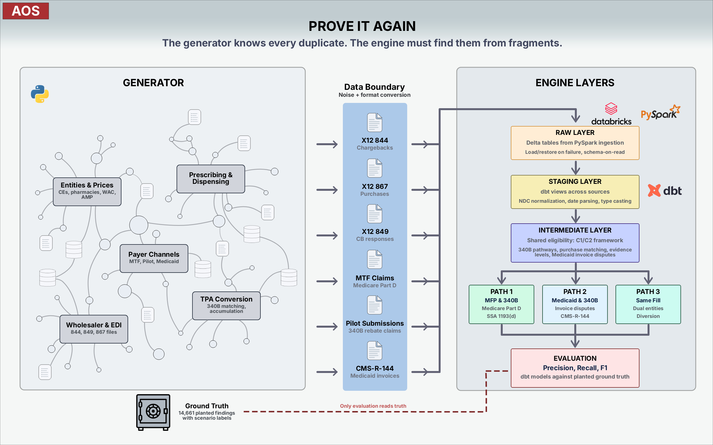

# 340B Duplicate Discount Detection Engine

When a drug qualifies for both a federal discount and a state or program rebate, the same unit can carry two price reductions that were never meant to overlap. Federal law prohibits these duplicate discounts, but finding them requires matching claims, purchase records and rebate invoices across systems that were not built to talk to each other.

This project does that matching. It takes the data a drug manufacturer actually receives - pharmacy claims, wholesaler chargeback files, rebate invoices, purchase reports - and walks each transaction through three detection paths, one for each type of overlap. Every finding is scored against planted ground truth so the detection can be measured.

> **All data in this project is completely synthetic.** No file describes a real organization, provider, patient or transaction. Real public data (drug names, published prices, state policies) is used only for sourced parameters and seeds. See [SYNTHETIC_DATA_NOTICE.md](SYNTHETIC_DATA_NOTICE.md).

## Why this project exists

Sun, Sarraille, Gambino and Martin (IQVIA, October 2026) sized MFP/340B duplicate discounts in aggregate using proprietary national data, estimating $6.1B to $9.3B for 2027 alone depending on the price period. This project builds on that work at a different level. It shows, on synthetic data, how individual duplicates are detected, reconciled against purchase records and evidenced at claim level. It does not estimate national totals, and its figures are not comparable to aggregate industry estimates.

Since the data used in this project is synthetic, every duplicate is planted, so each detection path is scored against known ground truth. Martin and Illich (IQVIA, 2022) note that no accessible data confirms which 340B-eligible claims were actually converted, which is why observational estimates cannot be checked this way.

The project takes no position in the policy debate over 340B. It shows how duplicates are detected and documented, not who is responsible for them. See [SYNTHETIC_DATA_NOTICE.md](SYNTHETIC_DATA_NOTICE.md).

## How it is organized

The `src/generator/` simulates the whole market and knows everything, including the ground truth. Everything from `src/ingestion/` onward sees only what a **manufacturer** could receive like covered entity claim submissions, EDI 844/849/867 files from wholesalers, Medicare Transaction Facilitator (MTF) records and state Medicaid rebate invoices. Ground truth sits in its own schema and is read only by the evaluation step; a test fails the build if any engine model references it.

| Folder | Contents |
|---|---|
| `src/generator/` | synthetic market, X12 writer (X12 is the EDI standard behind the 844, 849 and 867 files), planted scenarios |
| `src/ingestion/` | X12 parser, reference data loaders, NDC normalization |
| `dbt/` | staging, eligibility, reconciliation, three detection paths, evidence table, tests |
| `notebooks/` | pipeline steps and evaluation against ground truth |
| `samples/` | small extracts to inspect without running anything |
| `visuals/` | figures, Tableau workbook, interactive charts |
| `docs/` | design, references, data sources |

## Detection results

The engine's output is measured against 14,661 planted ground-truth situations (1,118 flagged as duplicates) across the three detection paths. The evaluation models read the truth schema; the detection engine never does.

### Path 1: MFP and 340B (Medicare Part D)

Detects units that received both an MFP refund through the Medicare Transaction Facilitator and a 340B discount (chargeback or Pilot rebate). The nonduplication rule under SSA 1193(d) requires a refund adjustment.

| Metric | Value |
|---|---|
| Precision | 0.8733 |
| Recall | 0.9707 |
| F1 | 0.9194 |

Path 1 has the strongest signal because both the MFP refund and the 340B purchase leave explicit records in the manufacturer's data.

### Paths 2 and 3

Path 2 (Medicaid and 340B) and Path 3 (same-fill diversion between entities) are implemented and evaluated but produce lower scores on synthetic data. Path 2 depends on state Medicaid invoice data (CMS-R-144) where the synthetic invoices do not replicate the full complexity of real state reporting. Path 3 detects the same prescription filled under two different entities' 340B accounts, a pattern that appears rarely and is hard to evidence without the Pilot platform's own matching.

These paths demonstrate the detection logic and the evidence the engine assembles for each finding. The scores reflect synthetic data limitations, not a ceiling on the method.

## Documentation

- [References](docs/REFERENCES.md)
- [Acronyms and terms](docs/ACRONYMS.md)

## How this was built

I built this project with Claude (Anthropic's AI assistant) as a pair programmer and research partner. The scope, the design and every decision behind it are mine, and I went through the primary sources with it (Federal Register notices, guidance from the Centers for Medicare & Medicaid Services (CMS) and the Health Resources and Services Administration (HRSA), the manufacturer plans for the 340B Rebate Model Pilot Program, the wholesaler EDI guides). Facts are checked against those sources and logged in [docs/REFERENCES.md](docs/REFERENCES.md). The tests in `tests/` are how I check that the code does what the docs say.
